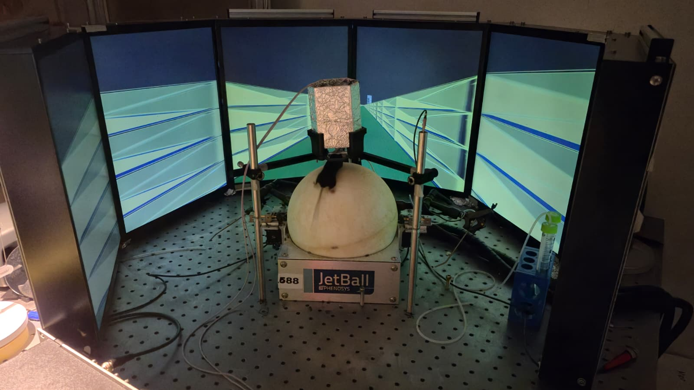
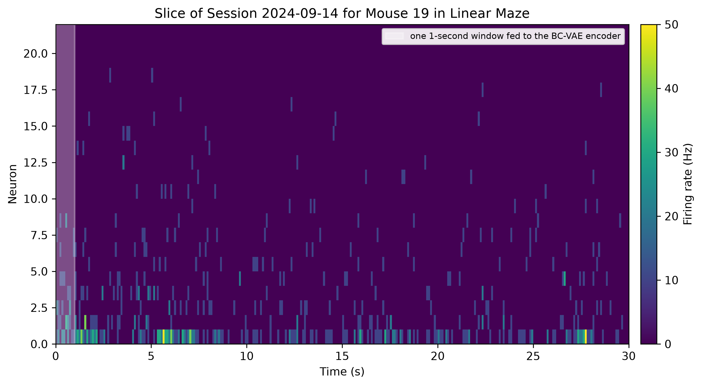
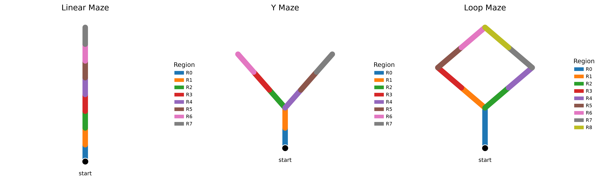
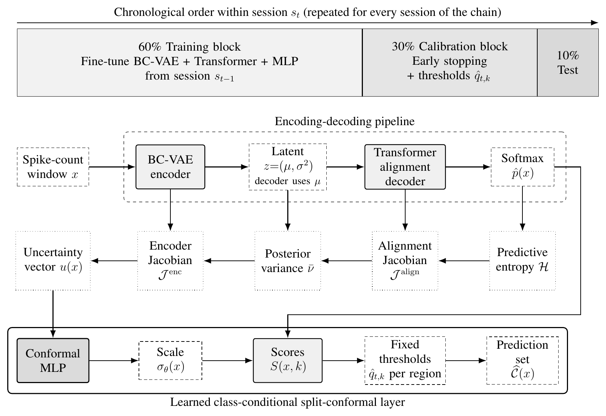
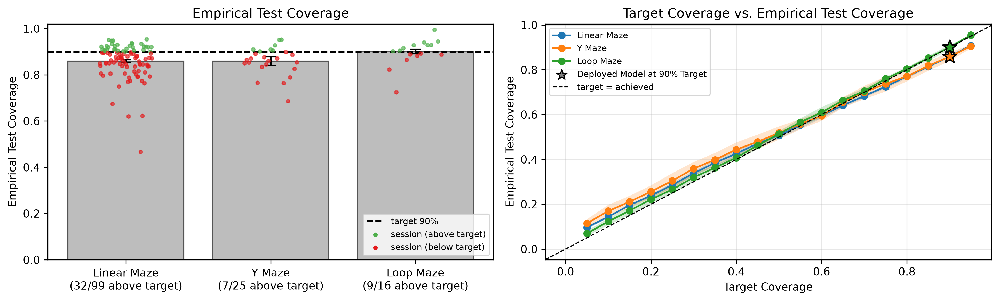
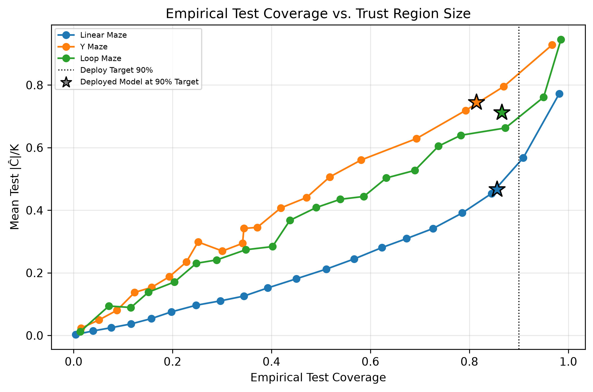
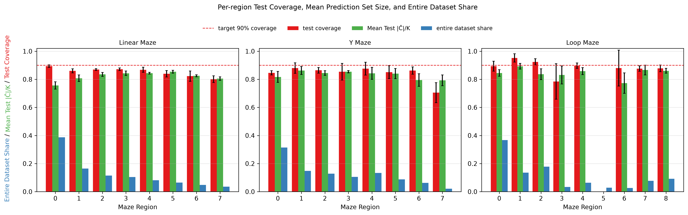
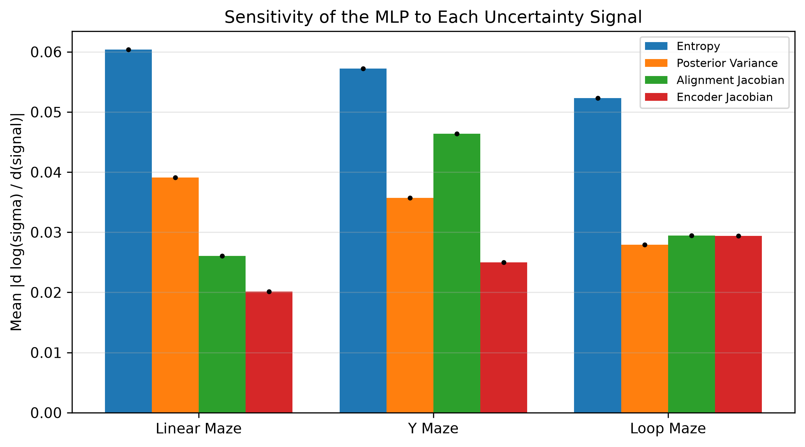

# Keeping Neural Decoders Calibrated Session by Session with Learned Class-Conditional Conformal Prediction

<div align="justify">

A major challenge for the lasting reliability of brain–computer interfaces in real-world conditions is neural drift, which degrades decoder performance and makes decoders unreliable over time. At inference time the decoder's predictions arrive without labels, so that decline cannot be measured. This paper proposes a learned class-conditional split-conformal layer that is calibrated on labeled data recorded before inference and then, without labels, turns each decoder output into a prediction set of plausible labels. A small network learns a per-input scale of the conformal score from four label-free uncertainty signals read from the latent space and the decoder, and one threshold is calibrated per class, borrowing calibration data from recent sessions for rare classes. The layer is deployed in a session-by-session chain that carries a behavior-constrained variational autoencoder and a Transformer decoder across recording sessions. On 149 sessions from 13 mice implanted with flexible probes in 3 virtual-reality mazes, over 5 seeds, the layer reached 86.0%, 85.9% and 90.1% coverage at a 90% target, against 76.8%, 70.0% and 88.1% for standard split-conformal prediction on a model trained per session. The size of each conformal prediction set then serves as a label-free measure of the decoder's reliability at inference time.

## Method

The recordings come from virtual-reality navigation sessions. A mouse runs on an omnidirectional ball in front of six monitors while a flexible brain probe records its neurons.

<p align="center">
  
</p>

Figure 1: Photograph of the experimental setup, which includes a mouse mounted on an omnidirectional ball, 6 monitors showing the maze environment, a flexible brain probe implanted in the animal, and an automated water delivery system.

A recording session is one continuous recording of one mouse in one maze, and each run through the maze is a trial. The spikes of every neuron are binned at 100 ms, and 10 consecutive bins form one 1 s input window.

<p align="center">
  
</p>

Figure 2: Firing rates over 30 seconds of the first trial of a Linear Maze session, from the trial's first spike. The highlighted region corresponds to a 1 s interval input for the BC-VAE.

Each window is labeled with the maze region the mouse occupies, which turns decoding into a classification task.

<p align="center">
  
</p>

Figure 3: The 3 maze layouts and their region labels. The black dot marks the start of a trial. The Linear Maze regions are defined relative to the reward position of each trial.

Each maze is processed as one session-by-session chain. Every session, from every mouse, is taken in calendar order. The model carried from the previous session is fine-tuned on the session's first 60% and recalibrated on the next 30%, and it then runs without labels on the final 10%, whose labels are used only to measure coverage.

<p align="center">
  
</p>

Figure 4: Data split protocol and full conformal pipeline. Top: the 60/30/10 split of one tested session of the chain. First row: the encoding-decoding pipeline maps each spike-count window to maze region probabilities $\hat p(x)$. Second row: the four uncertainty signals come together as $u(x)$. Third row: $u(x)$ is standardized and passed to the conformal MLP, which outputs the scale $\sigma_\theta(x)$. The scores $S(x,k) = (1-\hat p_k(x))/\sigma_\theta(x)$ are compared with the fixed thresholds $\hat q_{t,k}$ per region to produce the prediction set $\widehat{\mathcal{C}}(x)$.

## Results

All results come from the test blocks of the tested sessions, pooled over their windows within each maze, and are reported as the mean ± standard deviation across 5 seeds.

| Maze | Mice | Sessions | Tested | $K$ | Decoder Accuracy | Coverage | $\|\widehat{\mathcal{C}}\|/K$ |
|---|---|---|---|---|---|---|---|
| Linear Maze | 13 | 102 | 99 | 8 | 0.228 ± 0.002 | 0.860 ± 0.005 | 0.814 ± 0.010 |
| Y Maze | 7 | 28 | 25 | 8 | 0.132 ± 0.007 | 0.859 ± 0.019 | 0.835 ± 0.019 |
| Loop Maze | 3 | 19 | 16 | 9 | 0.313 ± 0.034 | 0.901 ± 0.010 | 0.851 ± 0.020 |

Table 1: Summary of decoder and conformal performance. Sessions counts every session of the chain, and Tested excludes the 3 warm-up sessions. $K$ is the number of maze regions. Coverage is the fraction of test windows whose prediction set contains the true region, at a 90% target.

<p align="center">
  
</p>

Figure 5: Calibration performance on test data. Left: empirical test coverage per maze against the 90% target, with each point one tested session's coverage averaged across seeds. Right: achieved test coverage when the conformal scale is retrained at every session for 19 coverage targets, 5% to 95% in 5% steps.

<p align="center">
  
</p>

Figure 6: Coverage-sharpness trade-off. Achieved test coverage against the mean prediction set size normalized by the number of maze regions, for the same 19 targets. The star marks the deployed 90% models of Table 1.

The method is compared with standard split-conformal prediction on a fresh model trained on each session alone. The mean coverage gap is the mean over tested sessions of $|\text{coverage} - 0.90|$.

| Maze | Method | Coverage | $\|\widehat{\mathcal{C}}\|/K$ | Mean coverage gap |
|---|---|---|---|---|
| Linear Maze | Method | 0.860 ± 0.005 | 0.814 ± 0.010 | 0.073 ± 0.007 |
| | Fresh model | 0.768 ± 0.008 | 0.674 ± 0.008 | 0.172 ± 0.006 |
| Y Maze | Method | 0.859 ± 0.019 | 0.835 ± 0.019 | 0.075 ± 0.012 |
| | Fresh model | 0.700 ± 0.033 | 0.638 ± 0.027 | 0.190 ± 0.029 |
| Loop Maze | Method | 0.901 ± 0.010 | 0.851 ± 0.020 | 0.053 ± 0.007 |
| | Fresh model | 0.881 ± 0.026 | 0.650 ± 0.028 | 0.104 ± 0.006 |

Table 2: Comparison with standard split-conformal prediction. Method: the session chain with the learned class-conditional split-conformal layer. Fresh model: an encoder-decoder trained from scratch on each session, with $\sigma_\theta \equiv 1$ and one threshold for all regions.

<p align="center">
  
</p>

Figure 7: Conformal performance per region and label distribution. Red bars show empirical test coverage, green bars the mean normalized prediction set size, and blue bars the region's share of the windows of the entire dataset. The dashed line marks the 90% target. Regions with fewer than 5 test windows are not reported.

| Maze | corr(decoder error, $\|\widehat{\mathcal{C}}\|/K$) |
|---|---|
| Linear Maze | +0.87 ± 0.05 |
| Y Maze | +0.37 ± 0.33 |
| Loop Maze | +0.58 ± 0.28 |

Table 3: Pearson correlation between decoder error and normalized prediction set size, over test windows grouped by set size and weighted by group size. Positive values indicate that decoder errors tend to coincide with larger prediction sets.

<p align="center">
  
</p>

Figure 8: Sensitivity of the learned conformal scale to each uncertainty signal, as the mean $|\partial \log \sigma_\theta(x) / \partial \tilde u_j(x)|$ per standard deviation of each standardized signal, averaged over the test windows of each maze.

The paper's LaTeX source is in [`paper/`](paper/README.md).

## Repository Structure

```text
conformal-neural-decoding/   # repository root
├── Makefile                 # setup, test, documentation, and analysis targets
├── LICENSE                  # Apache License 2.0
├── NOTICE                   # copyright notice and what the license does not cover
├── CITATION.cff             # citation metadata for the code and the paper
├── pyproject.toml           # Python package metadata and tool dependencies
├── uv.lock                  # locked uv environment
├── paper/                   # LaTeX source of the paper
├── src/                     # Python research package installed by uv
│   ├── data/                # datasets, neuron mapping, region labeling, data constants
│   ├── db/                  # MongoDB access and offline-testable connection helpers
│   ├── models/              # BC-VAE, Transformer decoder, training, and decoder metrics
│   ├── conformal/           # learned class-conditional split-conformal layer
│   ├── chain/               # session-by-session chain, calibration rules, and evaluation
│   └── utils/               # discovery, chronological splits, pipeline assembly, bundles
├── analyses/                # analysis notebooks and runner
│   ├── per_maze.ipynb       # session-chain training and evaluation for one maze and seed
│   ├── cross_maze.ipynb     # cross-maze comparison, paper tables and figures
│   ├── run_mazes.py         # papermill driver for executing per_maze.ipynb
│   └── artifacts/           # generated model and result bundles (gitignored)
├── docs/                    # MkDocs source pages and API documentation
├── tests/                   # pytest suite, documentation checks and paper checks
└── .github/                 # GitHub Actions workflows
```

## Setup

Install [`uv`](https://docs.astral.sh/uv/getting-started/installation/) first. The Makefile uses it to create and run the Python environment, but it does not install `uv` itself.

Choose the setup target that matches what you want to run:

```bash
make setup-python    # Python environment
make setup-docs      # adds the documentation spelling tools
make setup-latex     # adds TeX Live for the paper checks

make setup           # alias for setup-python
make setup-all       # all of the above
```

More details about setup are in the [`Makefile`](Makefile).

To access the database, copy `.env.example` to `.env` and fill in `MONGODB_URI`, `MONGODB_DATABASE`, and the `SSH_*` variables if you need an SSH tunnel. A dump of the database restored into a local MongoDB server works the same way: point `MONGODB_URI` at it and leave `SSH_HOST` empty. Restore it with the same MongoDB major version the dump came from.

## Running Code

The reusable research code lives in `src/`. The notebooks in `analyses/` are orchestration layers: they import from `src/`, choose the maze, run training and evaluation, and save the results.

`analyses/per_maze.ipynb` runs one maze's session-by-session chain for one seed: every usable session of every mouse, in calendar order, through the BC-VAE, the Transformer decoder and the conformal layer. `analyses/run_mazes.py` executes it with papermill for every maze and seed, and each run writes a bundle under `analyses/artifacts/<paradigm>/ALL_MICE/seed_<k>/`. After the bundles exist, `analyses/cross_maze.ipynb` reads them back and produces the paper's tables and figures, reported as the mean ± standard deviation across seeds.

```bash
make maze-quick                     # 2-epoch smoke test of the whole pipeline, one seed
make maze                           # all mazes (More_Water, Y_Maze, Nested_All) x seeds 42-46, resumable
make maze PARADIGM=Y_Maze SEEDS=42  # one maze, one seed
make cross-maze                     # compare the saved bundles across mazes and seeds
```

These runs need the `.env` database settings and a running MongoDB server, either the remote one or a local copy. More details are in [`analyses/README.md`](analyses/README.md) and [`src/README.md`](src/README.md).

The committed notebooks are executed, so their outputs can be read without the data: [`analyses/per_maze.ipynb`](analyses/per_maze.ipynb) holds the Linear Maze (`More_Water`) run for seed 42, and [`analyses/cross_maze.ipynb`](analyses/cross_maze.ipynb) holds the full comparison across all mazes and seeds reported in the paper.

## Documentation

The project documentation is an MkDocs site built from `docs/` and configured by `mkdocs.yml`, published at <https://ada-ggf25.github.io/conformal-neural-decoding/>. It is rebuilt and deployed to GitHub Pages every time a pull request that changes it is merged into `main`.

```bash
make mkdocs-serve   # preview the documentation locally
make mkdocs-test    # build the site in strict mode, as CI does
make docs-test      # lint and spell-check README files, WORKFLOWS.md, and docs/
```

## Running Tests

```bash
make ci-test   # every available test
```

See [`tests/README.md`](tests/README.md) for the detailed test layout, the [`Makefile`](Makefile) for the command definitions, and [`.github/WORKFLOWS.md`](.github/WORKFLOWS.md) for the CI workflow map.

## Data Availability

The recordings used in this paper were collected at the Harvard John A. Paulson School of Engineering and Applied Sciences and are not publicly available. Access to the database requires private credentials, and its setup is described in [`.env.example`](.env.example).

## Code Availability and Reproducibility

The code used to perform the paper's analyses is in this repository. Each maze's session chain was run with the random seeds 42, 43, 44, 45 and 46 by [`analyses/per_maze.ipynb`](analyses/per_maze.ipynb), executed through [`analyses/run_mazes.py`](analyses/run_mazes.py), and every figure and table of the paper was generated from the resulting bundles by [`analyses/cross_maze.ipynb`](analyses/cross_maze.ipynb), except the pipeline diagram and the photograph of the setup.

## Citation

The citation metadata are in [`CITATION.cff`](CITATION.cff), which GitHub turns into the "Cite this repository" button. A BibTeX entry with the arXiv identifier will be added once the preprint is available.

## License

The code is released under the [Apache License 2.0](LICENSE). The license does not cover the neural recordings, the NeurIPS style file in `paper/`, or the photograph of the recording setup; see [`NOTICE`](NOTICE).

## Acknowledgments

We thank our colleagues at the Harvard John A. Paulson School of Engineering and Applied Sciences and at Imperial College London for insightful discussions throughout the project.

</div>
