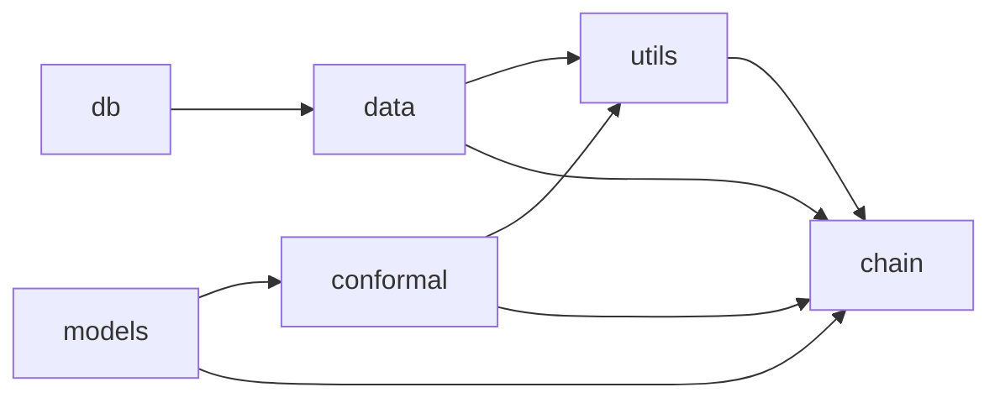

# API Reference

The `src` package is organized into six subpackages, each covering one layer of the pipeline. [The method](../pipeline.md) explains how they work together. The pages below document every public module, class and function, generated from the docstrings.

| Subpackage | What it covers |
|---|---|
| [`src.db`](db.md) | The MongoDB client with an optional SSH tunnel, the GridFS loaders for spikes and behavior, and session-name lookup |
| [`src.data`](data.md) | Extraction and binning, 1 s windows, maze-region labels, the task mask, the PyTorch datasets, and the recording constants |
| [`src.utils`](utils.md) | Session and cohort discovery, session assembly and the chronological split, the production recipe, and writing and reading result bundles |
| [`src.models`](models.md) | The BC-VAE encoder (Step 1), the Transformer alignment decoder (Step 2), their losses and training loops, and latent extraction |
| [`src.conformal`](conformal.md) | The four uncertainty signals, the learned scale, the conformal quantile, prediction sets, and the error correlations |
| [`src.chain`](chain.md) | The session chain: its order, the carried model, the per-region thresholds, evaluation, and the checkpointed runner |

## How the packages depend on each other

An arrow points from a package to the packages that import it. `src.models` imports none of the others: it trains on whatever the datasets of `src.data` yield, and `src.chain` is where the two are wired together. Package `__init__` files only hold a docstring: import every name from the module that defines it.

## Shared data structures

Most functions exchange plain dicts rather than classes. These are the recurring ones.

### Session data

`assemble_session_data` returns `session_data`, one dict per session keyed by its name. Later stages read it and add keys in place.

| Key | Shape | Meaning | Added by |
|---|---|---|---|
| `windows` | `(n_windows, T, n_neurons)` | binned firing rates; z-scored in place | `assemble_session_data`, `normalize_session_windows` |
| `windows_raw` | `(n_windows, T, n_neurons)` | the same windows before normalization, the Poisson target | `normalize_session_windows` |
| `regions` | `(n_windows,)` | the region label of every window | `assemble_session_data`, `apply_window_region_labels` |
| `train_idx`, `val_idx`, `test_idx` | index arrays | the chronological blocks, over task windows only | `assemble_session_data`, `resplit_warmup` |
| `x_positions`, `y_positions`, `water_positions` | `(n_bins,)` | per-bin position and the trial's water position | `assemble_session_data` |
| `straddle` | `(n_windows,)` | whether a window spans a region boundary | `apply_window_region_labels` |
| `step1_all_latents` | `(n_windows, latent_dim)` | the encoder's posterior mean for every window | `ChainModel.fit` |

`val_idx` is the calibration block. It was named for its first use, early stopping.

### Session configs

`build_hybrid_neuron_mapping` returns one config per session that fixes its column layout. `all_ids` lists the neuron ids in column order. `n_total`, `n_shared` and `n_specific` count them, `shared_indices` and `specific_indices` split the columns between the encoder's two projections, and `neuron_id_to_idx` maps an id to its column. The session chain treats every neuron as session-specific.

### Blocks and scores

Inside the chain, a set of windows moves through three dict forms:

| Form | Keys | Produced by |
|---|---|---|
| block | `probs`, `u` (raw signals), `labels` | `ChainModel.block` |
| scored block | `probs`, `sigma`, `labels`, `scores` (true-class scores) | `ChainModel.score` |
| evaluation | `covered`, `size_over_k`, `error`, `level`, one entry per window | `evaluate_block` |

A calibration block for `pooled_qhats` needs only `scores` and `labels`.

### Result bundles

`run_chain` returns one row per tested session, and `build_chain_bundle` turns the rows into `metrics.json` and `arrays.npz`. `load_maze_bundles` loads them back as `{paradigm: {seed: metrics}}`, adding the paths of the saved arrays and scale networks. The readers in `src.utils.bundle_readers` take either one bundle or one maze's `{seed: bundle}`.
