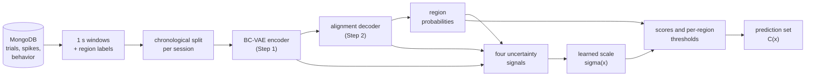

# The Method

This page follows one maze through the pipeline, from raw recordings to the numbers saved for each tested session. Every step names the function that implements it, and every setting is the value the production run uses. The settings come from `src.utils.production_config`, the model defaults in `src.models.config`, and the parameters of `analyses/per_maze.ipynb`.

## 1. Recordings, windows and regions

The data are virtual-reality navigation sessions. A mouse runs on an omnidirectional ball in front of six monitors while a flexible probe records its neurons.

{ width="640" }

Each session is a sequence of trials stored in MongoDB (`src.db`). Spike times are 10 kHz sample indices; behavior channels such as position are sampled at about 90 Hz. `extract_neural_and_position_hybrid` bins every neuron's spikes into 0.1 s bins as firing rates and averages the position onto the same bins. `create_windows_with_regions` then cuts the bins into non-overlapping windows of 10 bins (1 s). A window is the unit the model sees.

{ width="820" }

*Firing rates over 30 seconds of the first trial of a Linear maze session, from the trial's first spike. The highlighted interval is one 1 s input window.*

Only **task windows** enter training and evaluation: windows that lie entirely inside a trial whose status is `W` (`window_task_mask`). Each window is labeled with a maze **region**, one of \(K\) discrete classes, defined per maze by `src.data.regions`:

| Maze | Paradigm key | Regions \(K\) | How a position maps to a region |
|---|---|---|---|
| Linear | `More_Water` | 8 | Eight equal segments of the run from the start to the trial's water reward |
| Y maze | `Y_Maze` | 8 | Fixed cuts along the stem, then along each arm by the sign of `x` |
| Loop (Nested) | `Nested_All` | 9 | Fixed cuts; pools the `Nested_Maze` and `Nested_Maze+2` blocks |

In the Linear maze the regions follow the reward. `trial_water_position` finds each trial's water position from the behavior channels, and a trial without one stable position has no regions; its windows are left out. The production recipe labels a window by the **modal** region of its bins and drops windows that **straddle** a region boundary (`apply_window_region_labels`), since their label is ambiguous.

`assemble_session_data` keeps a session only if it has at least 5 neurons, 20 task windows and 2 distinct regions. Every neuron is treated as specific to its session: neuron identities are not matched across sessions.

## 2. The chronological split and the chain

Each session's task windows are split in time, never shuffled (`chronological_task_split`):

| Block | Share | Used for |
|---|---|---|
| Train | first 60% | fitting the encoder, the decoder and the scale \(\sigma_\theta\) |
| Calibration | next 30% | early stopping of all three stages, and the conformal thresholds |
| Test | last 10% | evaluation only |

A session needs at least 50 calibration and 20 test windows (`gate_sessions_conformal`). Each session's neurons are z-scored with its own training-block statistics (`normalize_session_windows`), so no statistic of a later block reaches the model.

The **chain** (`src.chain`) orders every usable session of the maze, across all mice, by recording date (`chain_order`). The first 3 sessions are a **warm-up**: they are split 70/30 into train and calibration blocks, trained on, and never tested. Their calibration blocks can still be borrowed by later sessions. A tested session is flagged as its mouse's *first* session in the chain or as a *returning* mouse, and results are reported for both groups.

For each session in order, `ChainModel.fit` fine-tunes the model carried from the previous session on the new session's training block. The session's own input layer and read-out are created when it arrives (`SharedTemporalClassifier.add_session`), so nothing learned earlier depends on a later session. Every stage restores the epoch with the best calibration-block loss. The first session is trained from scratch.

## 3. The two-step decoder

**Step 1, the BC-VAE encoder** (`SharedTemporalClassifier`). A window \(x\) of shape `(T, n_neurons)` is projected per bin, summarized by a bidirectional GRU, and mapped to a Gaussian posterior \(q(z \mid x) = \mathcal{N}(\mu, \operatorname{diag} e^{\log \sigma^2})\) over a 16-dimensional latent. A sample of the latent is decoded back to per-neuron Poisson rates, and a small head classifies the region from it. `train_step1` minimizes

\[
\mathcal{L}_1 = \mathrm{NLL}_{\text{Poisson}}(x_{\text{raw}}) + 0.2\,\mathrm{CE}(\text{region}) + w_{\text{KL}}\,\mathrm{KL}\big(q(z \mid x)\,\|\,\mathcal{N}(0, I)\big),
\]

where the reconstruction target is the unnormalized binned activity and the cross-entropy is unweighted: every window counts equally, so training optimizes raw accuracy, the reported metric (`CLASS_WEIGHTS = False`; turned on, both steps weight their cross-entropy by inverse region frequency). \(w_{\text{KL}}\) ramps linearly to 0.5 over the first 10 epochs, and only when training from scratch; a fine-tune uses the full weight at once.

**Step 2, the alignment decoder** (`AlignmentDecoder`). The encoder is frozen and each window is represented by its posterior mean. The decoder reads the means of the window and the 4 windows before it, front-padded at the session start. It passes them through a Transformer encoder and returns an aligned latent, which a classifier head turns into region probabilities \(\hat p(x) \in \Delta^{K-1}\). `train_step2` minimizes

\[
\mathcal{L}_2 = \mathrm{CE}(\text{region}) + 2\,\mathcal{L}_{\text{NT-Xent}},
\]

a contrastive term that pulls together windows of the same region and gives pairs from different sessions double weight (`compute_contrastive_loss`). Early stopping tracks the calibration-block cross-entropy alone.

## 4. The uncertainty signals

`window_signals` computes four signals per window, collected in the vector \(u(x)\) in the order of `SIGNALS`:

| Signal | Definition | What it measures |
|---|---|---|
| `entropy` | \(-\sum_k \hat p_k(x) \log \hat p_k(x)\) | how spread the decoder's prediction is |
| `variance` | mean of \(e^{\log \sigma^2}\) over latent dims | the encoder's own posterior uncertainty |
| `align_jacobian` | \(\lVert \partial z_{\text{aligned}} / \partial z_t \rVert_2\) | how sharply the alignment map reacts to the current latent |
| `enc_jacobian` | \(\lVert \partial \mu / \partial x \rVert_2\) | how sharply the encoder reacts to the input window |

The two Jacobian norms are largest singular values, computed by `src.conformal.strain`. `SignalStats` standardizes the signals with the mean and standard deviation of the session's training block, and those statistics are then frozen for its other blocks.

## 5. The conformal layer

**The score.** For a window \(x\) and a region \(k\), the non-conformity score divides the usual split-conformal score by a learned, strictly positive scale:

\[
S(x, k) = \frac{1 - \hat p_k(x)}{\sigma_\theta(x)}.
\]

A large \(\sigma_\theta(x)\) shrinks every score of that window, so more regions clear their thresholds and the prediction set grows. With \(\sigma_\theta \equiv 1\) the method is standard split conformal.

**The scale.** \(\sigma_\theta\) is a small MLP (`ScaleNet`, 2 hidden layers of 32 units) on the standardized signals. Its output is \(\exp\) of a pre-activation clamped to \([-3, 3]\). The last layer starts at zero, so training starts from \(\sigma_\theta = 1\) exactly. `train_scale` fits it on the training block with a smooth version of the conformal procedure. Each batch is halved in time: the earlier half gives per-region soft quantiles \(\tilde q_k\), and on the later half a region's set membership is \(\operatorname{sigmoid}\big((\tilde q_k - S(x,k))/\tau\big)\) with \(\tau = 0.05\). The loss is

\[
\mathcal{L}_\sigma = \overline{|\widetilde{\mathcal{C}}|} + \kappa \cdot \frac{1}{|R|} \sum_{c \in R} \max\big(0,\; (1-\alpha) - \widetilde{\mathrm{cov}}_c\big),
\]

the mean soft set size plus the coverage shortfall averaged over the regions \(R\) present in the batch, with \(\kappa = 20\). In the chain, each session fine-tunes the previous session's \(\sigma_\theta\), early-stopped on its calibration block.

**The thresholds.** For \(n\) calibration scores and miscoverage \(\alpha = 0.1\), `compute_quantile` returns the score of rank \(\lceil (n+1)(1-\alpha) \rceil\) in increasing order, or \(+\infty\) when that rank exceeds \(n\). If calibration and test windows are exchangeable, a test score falls at or below it with probability at least \(1-\alpha\). The method calibrates one threshold \(\hat q_k\) per region from the true-class scores of that region's calibration windows. Rule **B3** decides which windows those are (`pooled_qhats`):

1. **own:** the session's own calibration block, if it has at least \(\lceil 1/\alpha \rceil = 10\) windows of the region;
2. **borrowed:** otherwise, the own block pooled with the calibration blocks of the 3 previous sessions, if the pool has at least 10;
3. **global:** otherwise, one threshold from every window of the own block.

Borrowed blocks are re-scored with the current session's model and scale, so every pooled score comes from the same model. Test blocks are never pooled.

**The prediction set.** A test window's prediction set holds every region whose score clears its threshold (`class_conditional_prediction_sets`):

\[
\widehat{\mathcal{C}}(x) = \{\, k : S(x, k) \le \hat q_k \,\}.
\]

It can hold several regions or none.

## 6. What each tested session reports

`run_chain` evaluates every session after the warm-up on its test block, with the model right after its own fine-tune (`_evaluate_session`, `evaluate_block`). Several variants are computed on the same windows:

| Method | What differs |
|---|---|
| `chain_B3` | the deployed method |
| `chain_B1`, `chain_B5` | the same model with borrowing depth 1 or 5, a sensitivity analysis of the pool rule |
| `chain_sigma1` | the same model with \(\sigma_\theta \equiv 1\), an ablation of the learned scale |
| `fresh` | a new model trained from scratch on this session alone, with one global threshold (standard split conformal) |

For each method and test window, the run records whether the set covers the true region, the normalized set size \(|\widehat{\mathcal{C}}|/K\), the decoder's error, and whether the threshold was own, borrowed or global. The **coverage sweep** repeats the deployed method for 19 coverage targets from 5% to 95%. Each target other than 90% fine-tunes its own scale from the carried one. The 90% point is the deployed model itself.

`build_chain_bundle` pools these over the test windows of every tested session, and of the first-session and returning groups. It reports coverage against the 90% target, \(|\widehat{\mathcal{C}}|/K\), accuracy, the mean coverage gap (the mean over sessions of \(|\text{coverage} - 0.90|\)), and the share of each threshold level. Two readers go further:

- `error_correlations` checks whether the uncertainty signals track errors. It groups test windows by set size, or into 10 equal-count bins of \(\sigma_\theta\) relative to its session's median. Pearson's \(r\) between each group's mean value and its error rate is then weighted by group size.
- `signal_sensitivity` measures how much each signal drives the scale, as the mean \(\lvert \partial \log \sigma_\theta / \partial z \rvert\) per standard deviation of the signal.

## 7. Outputs

Each (maze, seed) run of `analyses/per_maze.ipynb` writes one bundle to `analyses/artifacts/<Paradigm>/ALL_MICE/seed_<seed>/`:

| File | Contents |
|---|---|
| `metrics.json` | the pooled summaries, per-session and per-region results, the sweep, the run's configuration (the notebook's parameters and the frozen hyperparameters), and every session's training curves |
| `arrays.npz` | one row per tested window: its session, region, probabilities, scale, relative scale, threshold level, the four signals, and each method's coverage, size and error; its index within its session, and its coverage and size at every sweep target; every calibration score the deployed model used (the session's own block and the re-scored past blocks), so any calibration rule can be recomputed offline; and the windows every session's scale was trained and calibrated on (probabilities, signals, regions), so another scale can be trained offline on the same decoder outputs |
| `sigma_nets.pt` | every tested session's scale network and signal statistics |

`src.utils.bundle_readers` reads bundles back and aggregates them across seeds as mean and standard deviation, which is what `analyses/cross_maze.ipynb` plots.
